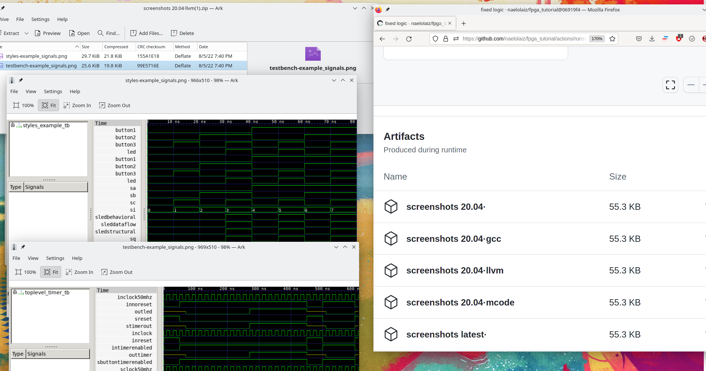

# fpga_tutorial

[](https://github.com/naelolaiz/fpga_tutorial/actions/workflows/ci.yml)
[](LICENSE)

A collection of small, self-contained FPGA/VHDL examples, each of which is
**simulated, synthesised into a logic diagram, and rendered as a waveform
screenshot** automatically on every push by GitHub Actions.

The goal is pedagogical: each example stays tiny, every artifact you'd want
to look at is generated reproducibly, and adding a new example is a
five-minute change (see [CONTRIBUTING.md](CONTRIBUTING.md)).

## What CI produces, per example

| Artifact                          | Tool chain                                   |
| --------------------------------- | -------------------------------------------- |
| `build/<tb>.vcd`                  | GHDL simulate                                |
| `build/<top>.svg` (netlist diagram) | yosys + ghdl-yosys-plugin → netlistsvg     |
| `build/<tb>.png` (waveform)       | GHDL → VCD → headless GTKWave (via Xvfb)     |

All three are uploaded as workflow artifacts and, for curated examples, also
committed into `doc/` for the README.



## Examples

| # | Example                                   | Concept                                         |
| - | ----------------------------------------- | ----------------------------------------------- |
| 1 | [`src/1-styles-vhdl`](src/1-styles-vhdl)  | Behavioural / dataflow / structural styles on a small sum-of-products |
| 3 | [`src/3-testbench`](src/3-testbench)      | Writing a testbench for a monostable multivibrator (one-shot timer)   |

## Repository layout

```
.
├── .github/
│   ├── actions/setup-hdl-tools/    # reusable composite action: installs the toolchain
│   └── workflows/ci.yml            # discover → lint → per-example build → status
├── mk/common.mk                    # every build rule, shared by every example
├── scripts/
│   ├── gtkwave_export.py           # headless VCD → PNG (argparse CLI, typed)
│   └── requirements.txt            # pinned Python deps
├── src/
│   ├── 1-styles-vhdl/              # example: Makefile + *.vhd
│   └── 3-testbench/                # example: Makefile + *.vhd
├── Makefile                        # top-level: auto-discovers every example
├── .vsg.yaml                       # VHDL Style Guide config (lint)
├── CONTRIBUTING.md
├── LICENSE
└── README.md
```

### Design principles

- **One Makefile rule set, everywhere.** Each example's `Makefile` only declares
  *what it is* (`TOP`, `TB_TOP`, `SRC_FILES`, `TB_FILES`). Every *how*
  (analyze / elaborate / simulate / diagram / screenshot) lives in
  [`mk/common.mk`](mk/common.mk). No copy-pasted rules.
- **Auto-discovery.** The top-level Makefile and the CI matrix both scan
  `src/*/Makefile` — adding an example never requires editing either.
- **Artifacts stay in `build/`.** `make clean` is a single `rm -rf`; nothing
  is scattered across the source tree.
- **CLI over magic.** `gtkwave_export.py` takes `--input` and `--output`
  explicitly instead of guessing paths from `argv[1]` — trivial to drive
  from a Makefile or a shell one-liner.

## Quick start

```bash
# Install the toolchain (Ubuntu 22.04+)
sudo apt-get install ghdl yosys yosys-plugin-ghdl gtkwave xvfb nodejs npm
sudo npm install -g netlistsvg
pip install -r scripts/requirements.txt

# Build everything (simulate + diagram + screenshot for every example)
make

# Or a single example
make -C src/1-styles-vhdl

# Or a single stage of a single example
make -C src/3-testbench simulate
```

The screenshot target needs an X server; on a headless machine wrap it with
`xvfb-run` exactly as CI does:

```bash
xvfb-run --auto-servernum make -C src/3-testbench screenshot
```

## Auto-generated artifacts (from CI)

Each CI run uploads a `<example>-artifacts` zip containing the VCD, SVG
netlist and PNG waveform. Screenshots of past runs:

- Logic diagrams: [`src/1-styles-vhdl/doc/dataflow_example.svg`](src/1-styles-vhdl/doc/dataflow_example.svg)
- GTKWave PNGs: see any CI run's artifacts tab.

## Alternatives to GTKWave for waveform viewing

- [sigrok](https://sigrok.org/wiki/Main_Page) — includes a CLI.
- [PulseView](https://sigrok.org/wiki/PulseView) — Qt frontend for sigrok
  with serial-bus decoders.
- [TerosHDL](https://github.com/TerosTechnology/vscode-terosHDL) in VS Code —
  inline signal + code view.

## License

MIT — see [LICENSE](LICENSE).
